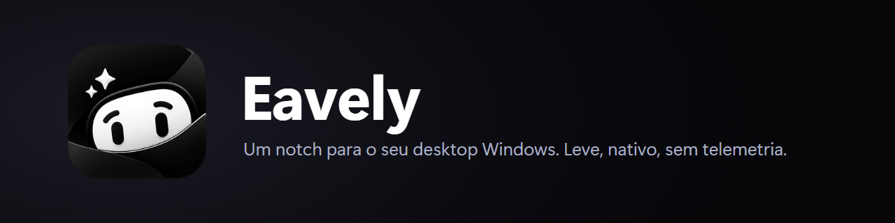
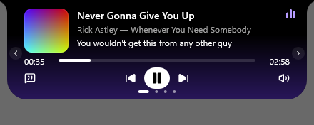
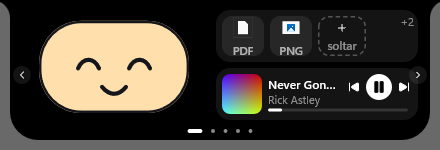
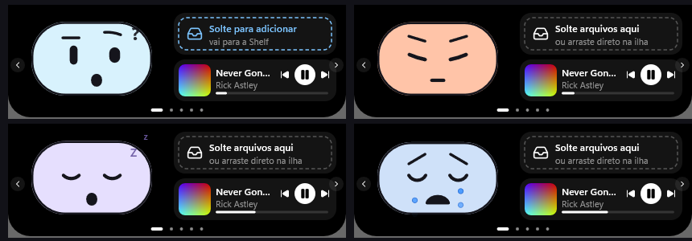
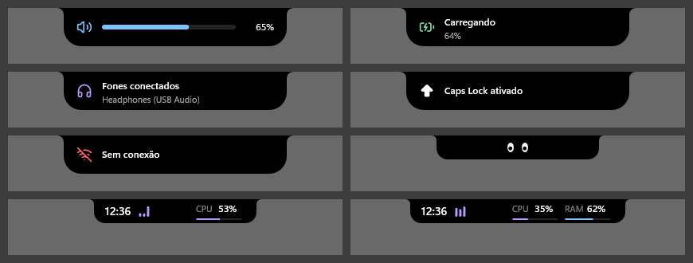

<div align="center">



# Eavely

**A notch for your Windows desktop: music with synced lyrics, pomodoro, file shelf and tasks, in a tiny 100% native app.**

[](https://github.com/LimaEdu-7x/eavely/releases/latest)


[Português](README.md)



</div>

---

## Features

- 🎵 **Music + synced lyrics** from whatever player is running (cover, progress, volume, split or compact lyrics).
- 🍅 **Pomodoro** with focus, short break and custom time.
- 📥 **File shelf**: drag files onto the island, drop them anywhere later.
- ✅ **Tasks** with time, calendar and editing.
- 🔔 **System overlays**: volume, battery, Wi-Fi, brightness (laptops only), headphones, Caps Lock (all off by default).
- 🖥️ **PC compact**: clock plus rotating CPU, RAM, GPU and network.
- 🙂 **Mascot** (new first tab): an expressive face that follows your mouse, blinks and reacts (music, dragging a file, clicks, night, low battery), with two configurable slots next to it (Files, mini Player, Tasks, Timer, Clock, PC metrics). It can also appear in the collapsed notch. Default personality: *Calm*.
- 📐 **Notch size**: Small / Standard / Large, applied instantly (*Settings → Mascot and start*).
- 👀 **Eyes** while idle (collapsed look: Battery and clock, Eyes or Mascot).
- 💤 **~0% CPU when idle (0.000 s CPU in 30 s, measured on v0.1.9)**, hides itself in fullscreen.
- ⚡ **Tunable performance** page: presets (Max smoothness / Balanced / Economy), frame rate Auto/60/30, animations, lyrics scroll (smooth or per line), effects.
- 🧱 **100% native, no WebView** (Rust + Direct2D/DirectComposition/DirectWrite).
- 🔒 **Local data**, no account, no telemetry.

<p align="center">
<br>

</p>

<p align="center">

</p>

## Install

1. Download from **[Releases](https://github.com/LimaEdu-7x/eavely/releases/latest)**: **`Eavely-Setup.exe`** (NSIS installer, per-user) or portable **`Eavely.exe`**. `Eavely.exe` is ~1.2 MB (1,211,904 bytes), `Eavely-Setup.exe` ~723 KB (740,543 bytes).
2. Run it. A tray icon gives you Settings and Quit.

**Unsigned binary warning.** Eavely has no code signing yet, so Windows may warn you:
- **SmartScreen**: click **More info → Run anyway**.
- **Smart App Control** (Windows 11, when on) may block it with no override. Build it yourself, or turn Smart App Control off in *Windows Security → App & browser control*. Turning it off is permanent (re-enabling needs a Windows reinstall) and lowers protection, so it's your call.

## Hotkeys

| Hotkey | Action |
|---|---|
| `Ctrl`+`Alt`+`E` | Show / hide the island |
| `Ctrl`+`Alt`+`T` | Start / pause the timer |
| `Ctrl`+`Alt`+`F` | Open the Shelf |

Configurable in Settings. Registered through Windows; no background keyboard hook.

## Privacy

- No telemetry, no account.
- The **only network use** is lyrics lookup on [LRCLIB](https://lrclib.net): track **title, artist and album** are sent. You can turn it off in *Settings → Music & lyrics → Show lyrics*.
- CPU/RAM/GPU/network stats are read locally and never leave your PC.
- Data lives in `%APPDATA%\Eavely`.

## Performance

RAM is reported as **private memory** (`PrivateMemorySize64`), the honest measure (working set swings as Windows trims pages). v0.1.9 release exe (not re-measured since v0.1.9): **5.6 MB** private when idle (working set ~36 MB), peak ~50 MB private with the island open and animating, idle CPU 0.000 s in 30 s (~0%). One machine, Windows 11. Details: [docs/perf/RESULTADOS.md](docs/perf/RESULTADOS.md).

## Build from source

Needs Rust (MSVC toolchain) on Windows 10/11:

```powershell
git clone https://github.com/LimaEdu-7x/eavely.git
cd eavely\app
cargo build --release
```

For the release exe (no local paths inside the binary): `powershell -File scripts/build-release.ps1`. **Do not export `RUSTFLAGS` manually:** an environment `RUSTFLAGS` overrides `+crt-static` from `app/.cargo/config.toml` (the exe would again need the VC++ Redistributable); use the script. Want to test in-development builds or contribute? See the [`dev` branch](https://github.com/LimaEdu-7x/eavely/tree/dev).

## Code signing and privacy

**The binaries are not code-signed yet** (unsigned builds; code signing is under evaluation), so Windows may warn or block them. To verify what you downloaded, compare the **SHA256** hash with the `SHA256SUMS.txt` of each Release, or build from source (see above). Details in [docs/CODE-SIGNING-POLICY.md](docs/CODE-SIGNING-POLICY.md).

- **Privacy:** no account, telemetry or auto-update. The only network access is the optional lyrics lookup at LRCLIB (title, artist, album, duration), which you can turn off in Settings. See [docs/PRIVACY.md](docs/PRIVACY.md).
- **Reporting abuse or a problem:** [Issues](https://github.com/LimaEdu-7x/eavely/issues), GitHub's private vulnerability reporting, or [contact.eavely@gmail.com](mailto:contact.eavely@gmail.com).

## Contact and support

- Bugs, ideas and questions: [GitHub Issues](https://github.com/LimaEdu-7x/eavely/issues).
- Project e-mail: [contact.eavely@gmail.com](mailto:contact.eavely@gmail.com).

## License and credits

MIT ([LICENSE](LICENSE)); the "Eavely" logo and name are reserved by the author, see [docs/BRAND.md](docs/BRAND.md). Icons: [Lucide](https://lucide.dev) (ISC), see [THIRD-PARTY-LICENSES.md](THIRD-PARTY-LICENSES.md). Lyrics: [LRCLIB](https://lrclib.net); lyrics belong to their authors.

## Independent project

Eavely is an independent, one-person project. It is **not affiliated with, sponsored by or endorsed by** any other notch/island app. Written from scratch, inspired by the behavior of notch apps; art and icons are original or open source (Lucide, ISC).
