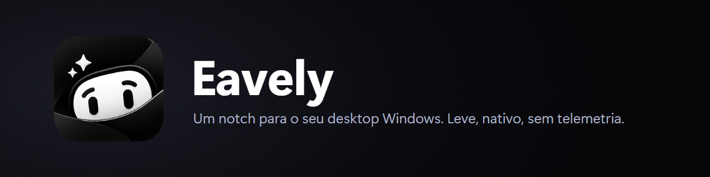
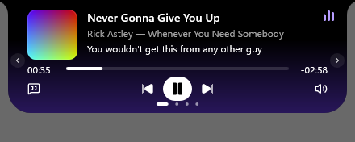
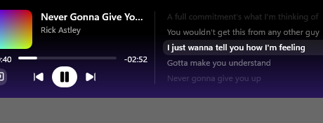
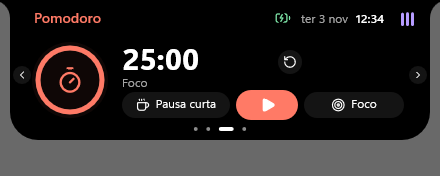
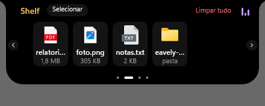
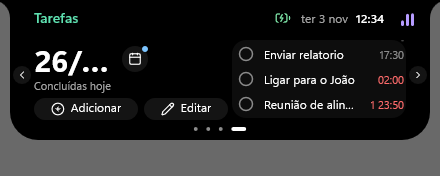
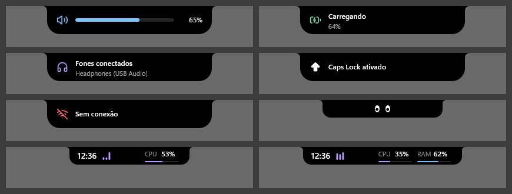
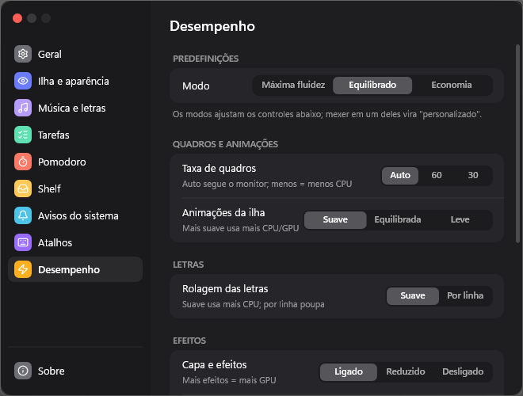
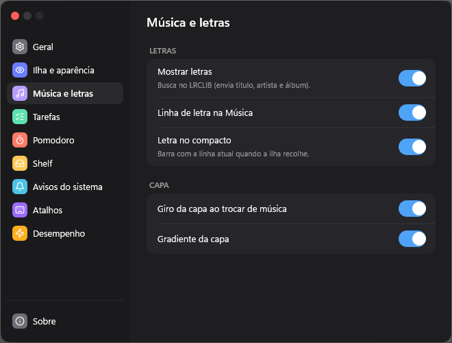
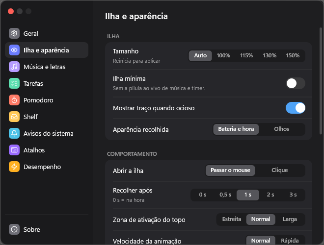

<div align="center">



# Eavely

**Um notch para o seu Windows: música com letras, pomodoro, shelf de arquivos e tarefas, num app minúsculo e 100% nativo.**

[](https://github.com/LimaEdu-7x/eavely/releases/latest)


[English](README.en.md) · [Recursos](#-recursos) · [Instalação](#-instalação) · [Atalhos](#atalhos) · [Privacidade](#-privacidade) · [Contato](#-contato-e-suporte) · [Compilar](#compilar-do-código)

<br>



</div>

---

## ✨ Recursos

| | |
|---|---|
| 🎵 **Música + letras sincronizadas** | Mostra a faixa do player que estiver tocando, com capa, barra de progresso, volume (passe o mouse no ícone para o slider) e letras linha a linha (tela dividida ou barra compacta; dá para desligar as letras no notch recolhido). |
| 🍅 **Pomodoro** | Foco, pausa curta e tempo personalizado, com anel de progresso e aviso ao terminar. |
| 📥 **Shelf de arquivos** | Arraste arquivos para a ilha e solte onde precisar. Seleção, exclusão e "limpar tudo"; nomes longos em até 2 linhas, com o nome inteiro ao passar o mouse. |
| ✅ **Tarefas** | Lista simples com horário, calendário e edição. |
| 🔔 **Avisos do sistema** | Volume, brilho (só em notebook), bateria, Wi-Fi, fones e Caps Lock aparecem (desligados por padrão; ligue em *Configurações → Avisos do sistema*) como pequenos overlays na ilha. |
| 🖥️ **Compacto de PC** | Hora e, rotativamente, CPU, RAM, GPU e rede, sem abrir nada. Em PC sem bateria mostra o ícone de rede (Wi-Fi com barras de sinal ou cabeada). |
| 🔘 **Mini notch** | Com uma janela maximizada, a ilha vira uma linha fina que só reage quando o cursor encosta nela. |
| 👀 **Olhos / pet** | A ilha ociosa pisca e dorme. Detalhe pequeno, mas dá vida. |
| 💤 **~0% de CPU parado** | Em repouso o app não desenha nada: 0,000 s de CPU em 30 s de teste (medido na v0.1.9). |
| ⚡ **Desempenho ajustável** | Presets Máxima fluidez, Equilibrado e Economia, taxa de quadros, animações e efeitos. |
| 🎮 **Esconde em tela cheia** | Jogo ou vídeo em tela cheia: a ilha some sozinha. |
| 🧱 **100% nativo, sem WebView** | Rust + Direct2D/DirectComposition/DirectWrite. Sem Electron, sem navegador embutido. |
| 🔒 **Dados locais** | Tarefas, Shelf e configurações ficam no seu PC. Sem conta, sem telemetria. |

## 🖼️ Capturas

<table>
<tr>
<td align="center"><br><sub>Letras sincronizadas</sub></td>
<td align="center"><br><sub>Pomodoro</sub></td>
</tr>
<tr>
<td align="center"><br><sub>Shelf de arquivos</sub></td>
<td align="center"><br><sub>Tarefas</sub></td>
</tr>
</table>

<p align="center">
<br>
<sub>Overlays (volume, brilho, bateria, fones, Caps Lock, Wi-Fi), olhos e compacto de PC</sub>
</p>

<table>
<tr>
<td align="center"><br><sub>Desempenho</sub></td>
<td align="center"><br><sub>Música e letras</sub></td>
</tr>
<tr>
<td align="center" colspan="2"><br><sub>Ilha e aparência</sub></td>
</tr>
</table>

## 📦 Instalação

1. Baixe o arquivo mais recente em **[Releases](https://github.com/LimaEdu-7x/eavely/releases/latest)**.
2. Escolha um formato: **`Eavely-Setup.exe`** (instalador NSIS, instala só para o seu usuário) ou **`Eavely.exe`** (portátil, basta dar dois cliques). `Eavely.exe` tem ~1,1 MB (1.098.752 bytes) e `Eavely-Setup.exe` ~680 KB (696.580 bytes) na v0.1.12. O instalador mostra um resumo de privacidade antes de instalar.
3. O ícone aparece na bandeja. Pelo menu dele você abre as Configurações e sai do app.

### ⚠️ Aviso do Windows (SmartScreen / Smart App Control)

O Eavely **ainda não tem assinatura de código** (o pedido de assinatura gratuita da SignPath Foundation está em andamento). Por isso o Windows desconfia de qualquer `.exe` novo e pouco baixado:

- **SmartScreen** ("O Windows protegeu seu PC"): clique em **Mais informações → Executar assim mesmo**.
- **Smart App Control** (Windows 11, quando está ativo): pode **bloquear sem opção de executar**. Nesse caso, ou você compila o app você mesmo, ou desativa o Smart App Control em *Segurança do Windows → Controle de aplicativos e do navegador*. **Atenção:** desativar é definitivo (só volta a ligar reinstalando o Windows) e reduz a proteção do sistema. A decisão é sua.
- Quer conferir o que está rodando? O código é aberto e dá para compilar do zero (veja abaixo).

## Atalhos

| Atalho | Ação |
|---|---|
| `Ctrl` + `Alt` + `E` | Mostrar / esconder a ilha |
| `Ctrl` + `Alt` + `T` | Iniciar / pausar o timer |
| `Ctrl` + `Alt` + `F` | Abrir a Shelf |

Dá para mudar os três em *Configurações → Atalhos*. É exigido Ctrl, Alt ou Win junto da tecla (nunca uma tecla solta). Os atalhos são registrados pelo Windows; o app não monitora o teclado em segundo plano.

## ⚙️ Configurações

Janela com barra lateral e cartões agrupados: **Geral**, **Ilha e aparência** (tamanho, abrir por hover ou clique, tempo para recolher, comportamento do mini notch, velocidade da animação, compacto de PC), **Música e letras**, **Tarefas**, **Pomodoro**, **Shelf**, **Avisos do sistema**, **Atalhos**, **Desempenho** e **Sobre**.

A página **Desempenho** tem presets (**Máxima fluidez**, **Equilibrado**, **Economia**; mexer em um controle vira "personalizado"), taxa de quadros **Auto/60/30**, nível das animações, rolagem das letras (**suave** ou **por linha**, que poupa CPU), efeitos da capa, equalizador e a opção de respeitar as animações do Windows.

## 🔐 Privacidade

- **Sem telemetria, sem conta, sem anúncios.**
- A **única conexão de rede** é a busca de letras no [LRCLIB](https://lrclib.net): são enviados o **título, o artista e o álbum** da faixa tocando. Dá para desligar em *Configurações → Música e letras → Mostrar letras*; o cache local continua valendo.
- Métricas de CPU, RAM, GPU e rede do compacto de PC são lidas **localmente** e nunca saem do computador.
- Política completa: [docs/PRIVACY.md](docs/PRIVACY.md).
- Seus dados ficam em `%APPDATA%\Eavely` (tarefas, Shelf, configurações e cache de letras). Apagar a pasta zera tudo.

## 📊 Desempenho

Os números de RAM do projeto são **memória privada** do processo (`PrivateMemorySize64`), não o *working set*. O working set oscila porque o Windows o corta e devolve páginas (o app libera o renderer ao recolher), então ele não mostra o que o processo reserva de fato. Por isso a memória privada é a medida honesta:

| Estado | Memória privada |
|---|---|
| Parado (recolhido), memória privada | **5,6 MB** |
| Pico de memória privada, ilha aberta e animando | ~50 MB |
| Working set parado (não é a medida honesta) | ~36 MB |

CPU parado: **0,000 s em 30 s** (~0%). Medido na v0.1.9 (exe de release; ainda não remedido na v0.1.11), em uma máquina só (Windows 11); em outras pode variar. Método e dados em [docs/perf/RESULTADOS.md](docs/perf/RESULTADOS.md).

## Compilar do código

Precisa do [Rust](https://rustup.rs) (toolchain MSVC) no Windows 10/11.

```powershell
git clone https://github.com/LimaEdu-7x/eavely.git
cd eavely\app
cargo build --release
# resultado: app\target\release\eavely.exe
```

Para o exe de release (sem caminhos da sua máquina dentro do binário): `powershell -File scripts/build-release.ps1`. Quer testar versões em desenvolvimento ou contribuir? Veja a [branch `dev`](https://github.com/LimaEdu-7x/eavely/tree/dev).

## 🔏 Assinatura de código e privacidade

Assinatura gratuita fornecida pela [SignPath.io](https://signpath.io), certificado da [SignPath Foundation](https://signpath.org) (pedido em andamento: **por enquanto os binários são publicados sem assinatura**, e as notas de cada Release avisam).

- **O que é assinado:** só os binários oficiais da página de Releases (`Eavely.exe`, `Eavely-Setup.exe`), compilados pelo GitHub Actions a partir deste repositório.
- **Papéis:** autor, revisor e aprovador: [@LimaEdu-7x](https://github.com/LimaEdu-7x). Cada assinatura é aprovada manualmente.
- **Privacidade:** sem conta, telemetria ou atualização automática. A única rede é a busca opcional de letras no LRCLIB (título, artista, álbum e duração), que dá para desligar em Configurações. Veja [docs/PRIVACY.md](docs/PRIVACY.md) e a [política de assinatura](docs/CODE-SIGNING-POLICY.md).
- **Problemas ou abuso:** [Issues](https://github.com/LimaEdu-7x/eavely/issues), o relato privado de vulnerabilidade do GitHub ou [contact.eavely@gmail.com](mailto:contact.eavely@gmail.com).

## 💬 Contato e suporte

- Bugs, ideias e dúvidas: [Issues do GitHub](https://github.com/LimaEdu-7x/eavely/issues).
- E-mail do projeto: [contact.eavely@gmail.com](mailto:contact.eavely@gmail.com).

## 📄 Licença e créditos

- Código sob licença **[MIT](LICENSE)**. A logo e o nome "Eavely" **não** estão cobertos pela MIT (direitos reservados ao autor; veja [docs/BRAND.md](docs/BRAND.md)).
- Ícones: [Lucide](https://lucide.dev) (ISC). Detalhes em [THIRD-PARTY-LICENSES.md](THIRD-PARTY-LICENSES.md).
- Letras: [LRCLIB](https://lrclib.net), serviço aberto e gratuito. As letras pertencem aos seus autores.

## ℹ️ Projeto independente

O Eavely é um projeto **independente e feito por uma pessoa só**. **Não é afiliado, patrocinado ou endossado** por nenhum outro app de ilha/notch. Escrito do zero, inspirado no comportamento de apps de notch; arte e ícones são originais ou open source (Lucide, ISC). Nomes de marcas pertencem aos seus donos.
