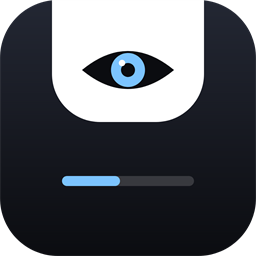

<div align="center">



# Eavely · branch `dev`

**Guia para quem desenvolve e testa o Eavely.** Aqui o app muda toda semana e pode quebrar.


[Branch dev](#-o-que-é-a-branch-dev) · [Compilar](#-compilar) · [Variáveis](#-variáveis-de-ambiente) · [Logs](#-logs-e-crashes) · [Reportar bug](#-reportar-um-bug) · [Roteiro](#-roteiro-de-teste)

📖 Procurando o app para usar no dia a dia? Veja o **[README principal](README.md)** ([English](README.en.md)).

</div>

---

## 🌿 O que é a branch `dev`

É onde entram as mudanças novas antes de irem para a `main`. Serve para **testar** funções em andamento e **achar bugs** cedo. O que você baixa daqui:

- pode ter bugs, telas incompletas e números de desempenho que ainda vão mudar;
- não tem garantia de compatibilidade entre versões (se algo quebrar, apagar `%APPDATA%\Eavely` zera os dados);
- pode ser compilado com ferramentas internas de teste (`--features devtools`) que **não** entram no exe de release.

### ⚠️ Builds de teste NÃO são assinados

Nenhum build do Eavely tem assinatura de código ainda. O Windows pode avisar ou bloquear:

- **SmartScreen:** *Mais informações → Executar assim mesmo*.
- **Smart App Control** (Windows 11, quando ativo): pode bloquear **sem opção de executar**. A saída segura é **compilar você mesmo** (abaixo). Desativar o Smart App Control é definitivo (só volta reinstalando o Windows), então só faça se entender o risco.
- Baixe builds de teste **só deste repositório**. Na dúvida, compile do código.

## 🔨 Compilar

Precisa do [Rust](https://rustup.rs) (toolchain **MSVC**) no Windows 10/11.

```powershell
git clone https://github.com/LimaEdu-7x/eavely.git
cd eavely
git checkout dev          # a branch de desenvolvimento
cd app
cargo build --release     # exe normal, igual ao que vai para o usuário
# resultado: app\target\release\eavely.exe
```

Para o exe que vai para a Release (sem caminhos da sua máquina dentro do binário), use `powershell -File scripts/build-release.ps1`.

Com as ferramentas internas de teste (captura de telas, log de quadros, mídia falsa):

```powershell
cargo build --release --features devtools
```

> ⚠️ O build com `devtools` é **só para teste**. Não distribua: ele lê variáveis `EAVELY_*` extras e pode gerar arquivos de captura/log.

## 🧪 Variáveis de ambiente

Todas são opcionais. Defina no PowerShell antes de abrir o exe, por exemplo `$env:EAVELY_LOG = "1"; .\eavely.exe`.

**Funcionam em qualquer build:**

| Variável | O que faz |
|---|---|
| `EAVELY_LOG` | Liga o log de diagnóstico em `%TEMP%\eavely-spike.log` (gira em 512 KB para `.old`; sem título, artista ou nomes de arquivo do usuário). Também liga sozinho após um panic ou violação de acesso. |
| `EAVELY_DATA_DIR` | Troca a pasta de dados (padrão `%APPDATA%\Eavely`). **Use em testes** para não sujar seus dados reais. |

**Só com `--features devtools`** (testes e capturas automatizados):

| Variável | O que faz |
|---|---|
| `EAVELY_FAKE_MEDIA` | Música falsa, para testar sem player real. |
| `EAVELY_FORCE` | Força o estado: `open`, `peek`, `live`, `line` (qualquer outro valor = oculto). |
| `EAVELY_PAGE` | Número da página inicial. |
| `EAVELY_SPLIT`, `EAVELY_DOCK`, `EAVELY_LIVE_EXPANDED` | Forçam tela dividida de letras, dock e ao vivo expandido. |
| `EAVELY_BENCH` / `EAVELY_SHOTS=pasta` / `EAVELY_BENCH_EXIT` | Roteiro automático que percorre os estados e salva capturas (da janela do Eavely) na pasta; `EXIT` fecha ao terminar. |
| `EAVELY_FRAMELOG=arq.csv` | Uma linha por quadro desenhado (tempos, tamanho, estado), para provar a suavidade. |
| `EAVELY_TEST_VOLUME`, `EAVELY_TEST_AUTOSTART`, `EAVELY_DRAG_ANY` | Testes internos (volume do sistema, iniciar com o Windows, arrasto). Não use no dia a dia. |

### Autoteste de animação

Vale no exe de **release** (não precisa de `devtools`):

```powershell
.\eavely.exe --selftest-anim              # grava %TEMP%\eavely-selftest.csv
.\eavely.exe --selftest-anim=saida.csv    # ou escolha o arquivo
```

Abre e fecha a ilha por código, grava um log por quadro e confere as curvas (overshoot, passos por quadro, duração). Não usa cliques sintéticos nem mexe em outros apps.

## 📜 Logs e crashes

| Arquivo | Onde | O que tem |
|---|---|---|
| `state.log` | `%APPDATA%\Eavely\state.log` (e `state.log.1`, o anterior) | **Sempre ligado.** Versão e PID de cada início, **motivo de cada saída** (Sair pela bandeja, fechamento do instalador, fim de sessão do Windows, queda) e aviso quando o encerramento anterior ficou sem registro (processo morto de fora), estado da ilha (liga/desliga/esconde), configurações de animação do Windows e linhas `CRASH:`. Gira em 200 KB. Sem dados pessoais. |
| `eavely-spike.log` | `%TEMP%\eavely-spike.log` | Diagnóstico detalhado (só com `EAVELY_LOG`, ou após panic/violação de acesso). |

Se o app **travar de forma inesperada**, ele se reinicia sozinho (com `--restart`), no máximo 3 vezes em 2 minutos, e grava `CRASH:` no `state.log`. Abrir a pasta: `explorer "$env:APPDATA\Eavely"`.

## 🐞 Reportar um bug

Abra uma *issue* no GitHub com:

1. **Versão** (Configurações → Sobre, ou a linha `inicio v…` do `state.log`) e **de onde veio** o exe (compilado por você ou baixado).
2. **Windows:** versão (`winver`), notebook ou desktop, **monitores** (quantidade, resolução, Hz).
3. **Passos** para reproduzir, numerados, e o que você esperava × o que aconteceu.
4. **Frequência:** sempre, às vezes, uma vez só.
5. **Anexos:**
   - o **`state.log`** (e `state.log.1` se existir);
   - uma captura **só da janela do Eavely** ou um vídeo curto.

> 🔒 **Antes de anexar, abra o arquivo e confira.** O `state.log` não deve ter dados pessoais, mas se tiver nome de usuário em algum caminho, **apague essa parte**. **Não** anexe capturas de tela inteira, nem nada com outras janelas, terminal, nomes de arquivos ou músicas que você não queira mostrar. **Nunca** anexe o conteúdo de `%APPDATA%\Eavely` inteiro (tem suas tarefas e a Shelf).

## ✅ Roteiro de teste

Marque o que testou e conte o resultado (passou / falhou / não deu para testar). Use `EAVELY_DATA_DIR` se não quiser mexer nos seus dados.

**🎵 Letras e quadros (60 Hz e 75 Hz)**
- [ ] Monitor a **60 Hz**: toque uma música com letra; a linha atual muda no tempo certo e a animação não engasga.
- [ ] Monitor a **75 Hz** (ou mais): mesma coisa; fica tão suave quanto a 60 Hz?
- [ ] Letras em *Suave* e em *Por linha* (Desempenho → Letras).
- [ ] Troca de música: giro da capa e letra nova sem sobrar a anterior.

**⚡ Presets de Desempenho**
- [ ] **Máxima fluidez**, **Equilibrado** e **Economia**: a ilha continua usável nos três?
- [ ] Taxa de quadros **Auto / 60 / 30** e animações *Suave / Equilibrada / Leve*.
- [ ] Mexer em um controle vira "personalizado" e o valor persiste ao reiniciar.
- [ ] Opção de respeitar as animações do Windows (ligue/desligue "Efeitos de animação" no Windows e veja).
- [ ] Parado, o uso de CPU no Gerenciador de Tarefas fica em ~0%.

**📥 Shelf**
- [ ] Arrastar 1 arquivo e vários; soltar fora da ilha.
- [ ] Modo seleção, excluir um, limpar tudo.
- [ ] Arquivo movido/apagado depois de entrar na Shelf: o app não quebra?
- [ ] Reiniciar o app: os itens continuam (ou somem, se "Shelf começa vazia" estiver ligado).

**🎮 Tela cheia**
- [ ] Vídeo/jogo em tela cheia: a ilha **some** e volta ao sair.
- [ ] Alt+Tab, janela sem borda e jogo em tela cheia exclusiva.

**🖥️ Vários monitores**
- [ ] A ilha aparece no monitor certo (opção "monitor" nas Configurações; padrão: onde está o cursor).
- [ ] Monitores com escalas diferentes (100% e 150%): o tamanho e a nitidez estão corretos?
- [ ] Desconectar e reconectar um monitor com o app aberto.

**Extras rápidos:** atalhos `Ctrl+Alt+E/T/F`, overlays (volume, brilho, bateria, Wi-Fi, fones, Caps Lock), Pomodoro até o fim, Tarefas com dia, compacto de PC, iniciar com o Windows.

## 🔏 Assinatura de código e privacidade

Assinatura gratuita fornecida pela [SignPath.io](https://signpath.io), certificado da [SignPath Foundation](https://signpath.org) (pedido em andamento: **por enquanto os binários são publicados sem assinatura**, e as notas de cada Release avisam).

- **O que é assinado:** só os binários oficiais da página de Releases (`Eavely.exe`, `Eavely-Setup.exe`), compilados pelo GitHub Actions a partir deste repositório.
- **Papéis:** autor, revisor e aprovador: [@LimaEdu-7x](https://github.com/LimaEdu-7x). Cada assinatura é aprovada manualmente.
- **Privacidade:** sem conta, telemetria ou atualização automática. A única rede é a busca opcional de letras no LRCLIB (título, artista, álbum e duração), que dá para desligar em Configurações. Veja [docs/PRIVACY.md](docs/PRIVACY.md) e a [política de assinatura](docs/CODE-SIGNING-POLICY.md).
- **Problemas ou abuso:** [Issues](https://github.com/LimaEdu-7x/eavely/issues) ou o relato privado de vulnerabilidade do GitHub.

## 📄 Licença e créditos

MIT ([LICENSE](LICENSE)). Ícones: [Lucide](https://lucide.dev) (ISC), veja [THIRD-PARTY-LICENSES.md](THIRD-PARTY-LICENSES.md). Letras: [LRCLIB](https://lrclib.net). Projeto independente, **não afiliado a nenhum outro app de notch**.
